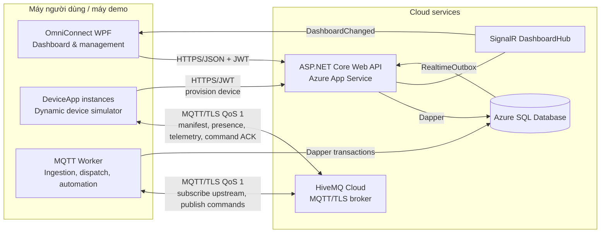
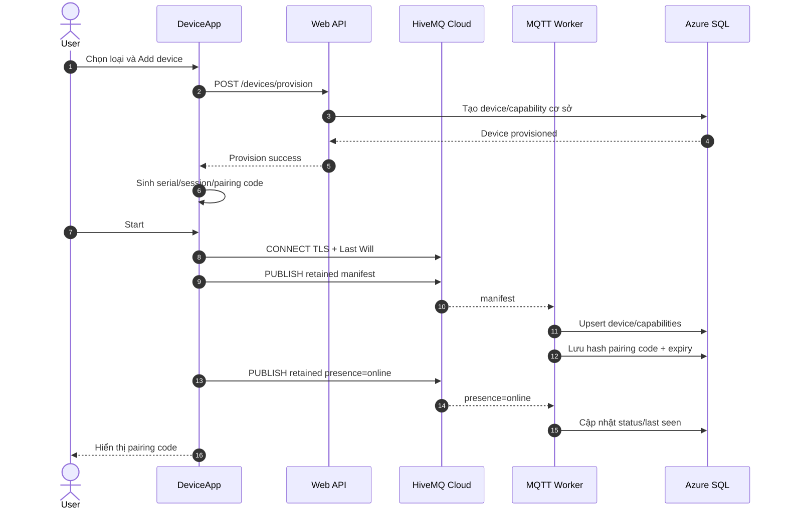
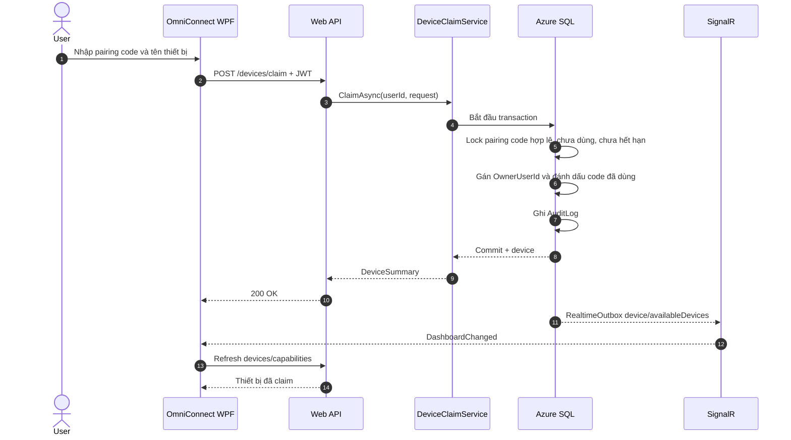
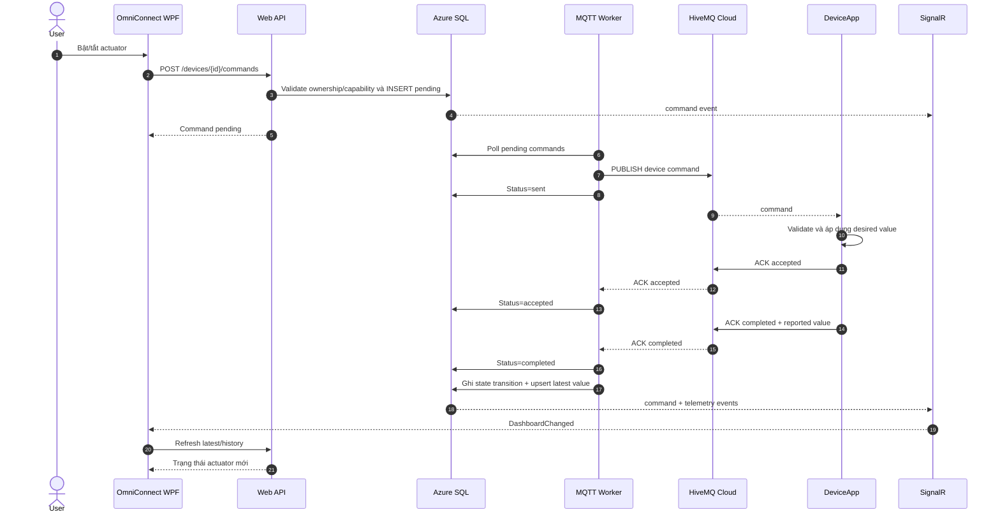
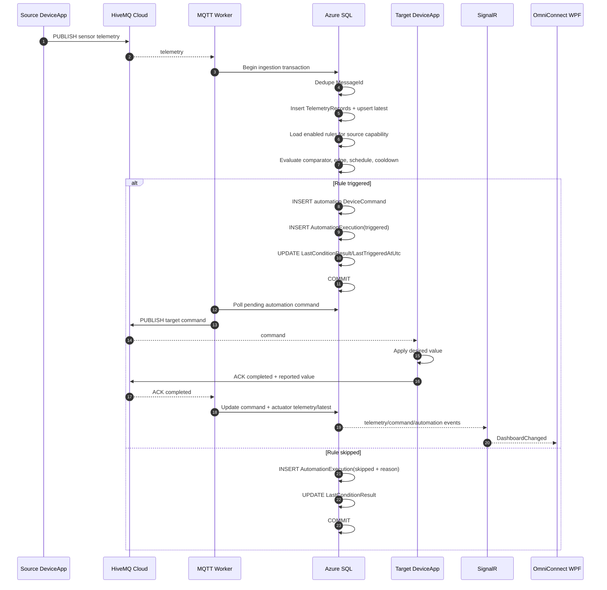

# Architecture and sequence diagrams

## System architecture

Luồng dữ liệu chính:

- Upstream: DeviceApp → HiveMQ → Worker → Azure SQL.
- Downstream: WPF/API hoặc automation → Azure SQL → Worker → HiveMQ → DeviceApp.
- Realtime UI: SQL trigger → `RealtimeOutbox` → API dispatcher → SignalR → WPF.

## Sequence 1 — Device startup, manifest and pairing code

## Sequence 2 — Claim device from OmniConnect

## Sequence 3 — Manual actuator command and ACK

## Sequence 4 — Sensor telemetry triggers automation

