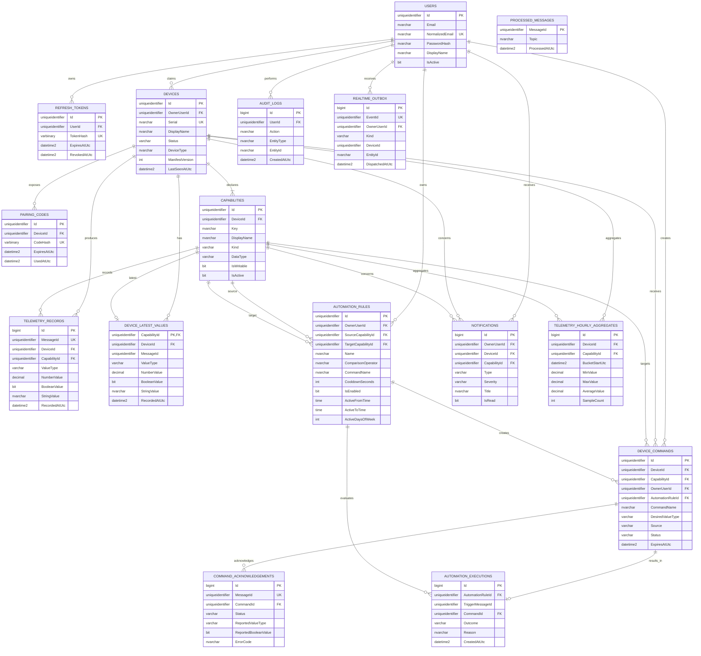
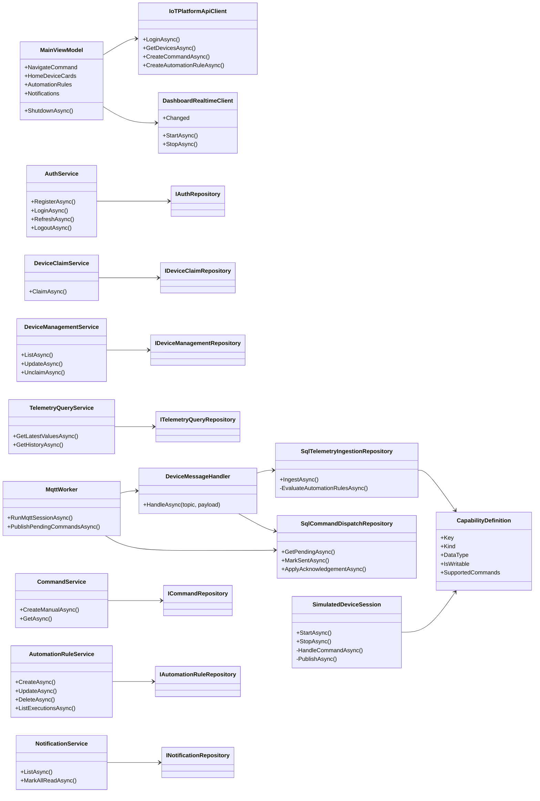

# Domain and data model diagrams

## Entity relationship diagram

Ghi chú:

- `TelemetryRecords` giữ lịch sử; `DeviceLatestValues` tối ưu truy vấn dashboard.
- Dynamic value chỉ sử dụng đúng một cột number/boolean/string theo `ValueType`.
- `ProcessedMessages` độc lập để chống xử lý trùng MQTT QoS 1.
- `RealtimeOutbox` được SQL trigger tạo và API dispatcher phát qua SignalR.

## Application class diagram

